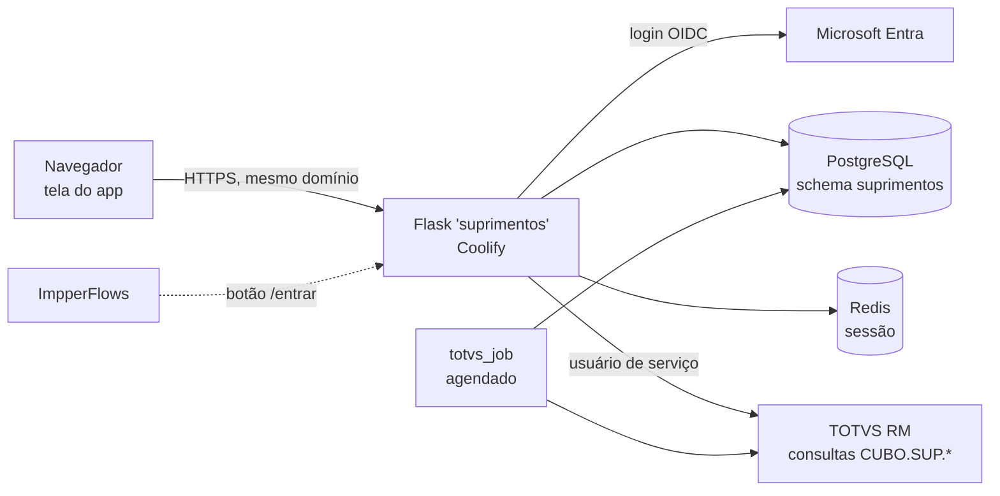

# Central de Suprimentos

App de gestão de suprimentos de obras do Grupo Impper. Cobre o caminho **SC → Mesa de Compras → Cotação → OC → recebimento → almoxarifado**, com prazos (SLA), avaliação e cadastro de fornecedores, verbas (orçado × comprado), Curva 25 e painéis.

Roda no servidor da empresa, no mesmo padrão do **ImpperFlows** (Plataforma de Automações): Flask, PostgreSQL, Redis e login Microsoft Entra, publicado pelo Coolify. Os dados de compras vêm do **TOTVS RM**, lidos pelo servidor com um usuário de serviço.

> Uso interno do Grupo Impper. Não é software livre: veja [Autoria e uso](#autoria-e-uso).

---

## Sumário

- [O que o app faz](#o-que-o-app-faz)
- [Arquitetura](#arquitetura)
- [Estrutura do repositório](#estrutura-do-repositório)
- [Rodar no próprio PC](#rodar-no-próprio-pc)
- [Publicar (Coolify)](#publicar-coolify)
- [Configuração](#configuração)
- [TOTVS RM](#totvs-rm)
- [Acesso pelo ImpperFlows](#acesso-pelo-impperflows)
- [Testes](#testes)
- [Segurança e LGPD](#segurança-e-lgpd)
- [Documentação](#documentação)
- [Autoria e uso](#autoria-e-uso)

---

## O que o app faz

| Aba | Para quê |
|---|---|
| Visão Geral | Painel com "Meu dia" e gráficos configuráveis por pessoa (filtro, tipo e tamanho de cada quadro) |
| Solicitações de Compra | SCs do RM por obra, responsável e prazo, com conferência de erros da obra |
| Mesa de Compras | O que está com cada comprador, ranking do mês |
| Quadro de Cotação | Mapa de cotação, com verba (saldo) e histórico de preço por item |
| Ordens de Compra | OCs por item, aprovação, recebimento, envio ao fornecedor (PDF e e-mail) |
| Regularizações | Pedidos já comprados ou faturados pela obra |
| Pré-Compras | Pacotes padrão, validação antes da SC e contratações até o contrato assinado |
| Anotações | Notas e tarefas da equipe |
| Base de Insumos | Insumos do RM e pedidos de cadastro |
| Verbas | Orçado, realizado, comprometido e saldo por tarefa |
| Prazos SLA | Prazo da obra (criação → necessidade) e prazos de compra e aprovação |
| Fornecedores | Cadastro (consulta de CNPJ e IE), pedidos de cadastro e avaliação mensal |
| Almoxarifado | Estoque da obra, saídas, recebimentos, transferências e inventário |
| Curva 25 | Cronograma de compras, orçado × comprado |
| Configurações | Usuários e permissões, integração TOTVS, gravação no RM, parâmetros |

Também tem: assistente que responde perguntas sobre os dados (sem IA; IA externa opcional), calculadora de suprimentos, chat da equipe e notificações.

## Arquitetura



- A **tela** é um único `index.html` (`servidor/app/static/`) e só conversa com o próprio servidor.
- O **servidor** confere login e permissão em toda leitura e gravação (`servidor/app/permissoes.py`). Quem tem obras limitadas no perfil só recebe essas obras.
- O **TOTVS** é lido pelo servidor: uma tarefa agendada (`python -m app.totvs_job auto`) atualiza SC, OC, verbas, insumos e fornecedores, e a tela recebe o resultado. A senha do RM nunca chega ao navegador.
- A **gravação no RM** (cadastros, observações, movimentos do almoxarifado e, no futuro, a OC) já está pronta, mas fica **desligada** até a homologação ([docs/05](docs/05-gravacao-no-rm.md)).

## Estrutura do repositório

```text
.
├── servidor/                 # app Flask (o que vai para o Coolify)
│   ├── app/
│   │   ├── __init__.py       # cria o app, login Entra, cabeçalhos de segurança, /entrar
│   │   ├── config.py         # tudo vem de variáveis de ambiente
│   │   ├── usuario.py        # sessão e perfil
│   │   ├── permissoes.py     # quem pode ler/gravar cada documento
│   │   ├── obras.py          # restrição por obra
│   │   ├── rotas_db.py       # /api/db
│   │   ├── rotas_app.py      # página, /api/sessao, /totvs, chat, arquivos
│   │   ├── totvs_job.py      # atualização automática do RM
│   │   ├── agenda.py         # ritmo da atualização (rápida, diária, completa)
│   │   ├── rm_gravacao.py    # gravação no RM (desligada por padrão)
│   │   ├── ia.py             # IA do assistente (opcional, desligada)
│   │   └── static/           # tela do app (index.html e arquivos)
│   ├── testes/               # testes do servidor
│   ├── Dockerfile
│   ├── docker-compose.local.yml
│   ├── gunicorn.conf.py
│   ├── requirements.txt
│   ├── .env.exemplo          # modelo das variáveis (produção)
│   └── .env.local.exemplo    # modelo para rodar no PC
├── banco/                    # SQL do PostgreSQL (usuário do app e tabelas)
├── totvs-sql/                # consultas do RM (CUBO.SUP.*) e as que faltam criar
├── testes-de-aceite/         # casos com entrada e resultado esperado das regras
├── docs/                     # documentação (ver lista abaixo)
├── ENTREGA-COMPLETA.md       # instalação completa, variáveis, segurança, homologação
├── RODAR-NO-PC.md            # subir tudo com Docker no próprio PC
├── CHANGELOG.md
└── CREDITOS.md
```

## Rodar no próprio PC

Precisa de **Docker Desktop** e de um registro de app no Entra com a URI de retorno `http://localhost:3000/getAToken`. Na pasta `servidor/`, no Windows:

```bash
copy .env.local.exemplo .env.local
```

Preencha o `.env.local` (`SECRET_KEY`, `AUTHORITY`, `CLIENT_ID`, `CLIENT_SECRET`, `ADMIN_EMAILS` e, para ver dados, o RM) e suba:

```bash
docker compose -f docker-compose.local.yml up --build
```

Depois abra **http://localhost:3000**. O passo a passo e os problemas comuns estão em [RODAR-NO-PC.md](RODAR-NO-PC.md).

## Publicar (Coolify)

1. **Banco:** rodar `banco/00-usuario-do-app.sql` e depois `banco/01-estrutura.sql` (schema `suprimentos` no PostgreSQL `automacoes`).
2. **Entra:** registrar o app, com a URL de retorno `https://<endereço>/getAToken`.
3. **RM:** criar o usuário de serviço só de leitura e liberar as consultas `CUBO.SUP.*` ([totvs-sql/](totvs-sql/README.md)).
4. **Coolify:** novo recurso a partir da pasta `servidor/` (Dockerfile, porta 3000, verificação em `/saude`), com as variáveis do `servidor/.env.exemplo`.
5. **Agendar** `python -m app.totvs_job auto` a cada 5 minutos (`*/5 * * * *`). O ritmo real é definido pelo administrador na tela.
6. **Entrar** com um e-mail de `ADMIN_EMAILS`, definir "Buscar desde" e rodar a primeira atualização completa.

O app começa limpo: não há dados a importar. Os detalhes estão em [ENTREGA-COMPLETA.md](ENTREGA-COMPLETA.md).

## Configuração

Tudo por variável de ambiente. Nada de senha no código, e o `.env` não vai para o Git. As principais:

| Variável | Para quê |
|---|---|
| `SECRET_KEY` | Assina a sessão |
| `SESSION_REDIS_URL`, `SESSION_KEY_PREFIX` | Redis da sessão (pode ser o mesmo do ImpperFlows, com prefixo `suprimentos:`) |
| `DATABASE_URL`, `DB_NAME`, `DB_SCHEMA` | PostgreSQL (`automacoes` / `suprimentos`) |
| `AUTHORITY`, `CLIENT_ID`, `CLIENT_SECRET`, `REDIRECT_URI` | Login Microsoft Entra |
| `DOMINIO_PERMITIDO`, `GRUPOS_ACESSO`, `ADMIN_EMAILS` | Quem entra e quem é administrador no início |
| `TOTVS_BASE_URL`, `rm_user`, `rm_senha` | RM com usuário de serviço (senha em Base64, como no ImpperFlows) |
| `RM_GRAVACAO_ATIVA`, `rm_grav_user`, `rm_grav_senha`, `RM_GRAVACAO_PERMITIDOS` | Gravação no RM (desligada por padrão) |
| `PORTAL_URL`, `PORTAL_NOME` | Link "Voltar ao ImpperFlows" no menu |
| `IA_PROVEDOR` | IA do assistente (vazio = desligada) |

A lista completa, com exemplos, está na seção 5 do [ENTREGA-COMPLETA.md](ENTREGA-COMPLETA.md).

## TOTVS RM

- **Leitura:** consultas SQL do RM (`RealizaConsulta`) com o prefixo `CUBO.SUP.*`. Os SQLs estão em `totvs-sql/`, e as que ainda faltam criar no RM estão em `totvs-sql/PARA-CRIAR-NO-RM/`.
- **Atualização automática:** o servidor busca SC e OC de 15 em 15 minutos, verbas e insumos uma vez por dia, e faz uma completa por semana. O administrador define a agenda na tela.
- **Gravação (próximo passo):** `SaveRecord` e `ExecuteWithXmlParams` com usuário só de gravação e lista fechada de operações. A Central chega a emitir a OC ([docs/05](docs/05-gravacao-no-rm.md)).

## Acesso pelo ImpperFlows

O ImpperFlows terá um botão para a Central. O botão aponta para **`https://<endereço da Central>/entrar`**:
- quem já está logado na conta Microsoft entra direto, sem tela de login e sem escolher a conta;
- `/entrar?aba=sc` (ou `oc`, `almox`, `forn`…) abre direto numa aba, se a pessoa tiver acesso.

A Central não pode ser aberta dentro de um quadro (iframe) de outro site: abra em aba nova. O passo a passo, com o código do item de menu, está em [docs/07](docs/07-acesso-pelo-impperflows.md).

## Testes

Na pasta `servidor/`:

| Comando | O que testa | Precisa de |
|---|---|---|
| `python testes/testar_entrar.py` | Rota `/entrar` com a biblioteca de login real | Nada (sem banco) |
| `python testes/testar_agenda.py` | Agenda da atualização automática | Nada (sem banco) |
| `python testes/testar_gravacao.py` | Gravação no RM com RM falso | PostgreSQL de teste (variáveis do banco de teste) |
| `python testes/rodar_local.py` e, em outro terminal, `python testes/testar_api.py` | 71 testes de rotas e permissões | PostgreSQL de teste. **Apaga as tabelas do schema `suprimentos`**; nunca rodar no banco de produção |

As regras de negócio têm casos de aceite em `testes-de-aceite/` (13 de 13 OK). Detalhes em [servidor/testes/LEIA-ME.md](servidor/testes/LEIA-ME.md).

## Segurança e LGPD

- Login só com a conta Microsoft da empresa (domínio e, se quiser, grupos do Entra).
- Permissão conferida **no servidor** em toda consulta e gravação, não só no menu. Auditoria de quem fez o quê.
- Cookie de sessão `Secure`, `HttpOnly`, `SameSite=Lax`.
- Cabeçalhos: CSP, `X-Frame-Options: DENY`, `frame-ancestors 'none'`, `nosniff`.
- Sem rota de depuração, sem senha no código, sem anexo acessível pelo número.
- Inventário de dados pessoais, retenção e pedido de titular em [docs/02-LGPD.md](docs/02-LGPD.md).

Encontrou um problema de segurança? Avise a TI diretamente, não por issue pública.

## Documentação

| Documento | Conteúdo |
|---|---|
| [ENTREGA-COMPLETA.md](ENTREGA-COMPLETA.md) | Arquitetura, instalação, variáveis, agendamentos, segurança, homologação |
| [RODAR-NO-PC.md](RODAR-NO-PC.md) | Testar no PC com Docker |
| [docs/01-regras-de-negocio.md](docs/01-regras-de-negocio.md) | As regras que o app calcula |
| [docs/02-LGPD.md](docs/02-LGPD.md) | Dados pessoais, retenção, titular |
| [docs/03-abas-o-que-cada-uma-precisa.md](docs/03-abas-o-que-cada-uma-precisa.md) | Aba por aba: de onde vêm os dados e como conferir |
| [docs/04-integracao-totvs.md](docs/04-integracao-totvs.md) | Integração de leitura com o RM |
| [docs/05-gravacao-no-rm.md](docs/05-gravacao-no-rm.md) | Gravação no RM, até emitir a OC pela Central |
| [docs/06-almoxarifado-como-comecar.md](docs/06-almoxarifado-como-comecar.md) | Começar a gestão de estoque em cada obra |
| [docs/07-acesso-pelo-impperflows.md](docs/07-acesso-pelo-impperflows.md) | Botão da Central dentro do ImpperFlows |
| [CHANGELOG.md](CHANGELOG.md) | Histórico de versões |

## Autoria e uso

- **Titular:** Grupo Impper, pelo Termo de Entrega e Cessão de Direitos (a ser assinado).
- **Desenvolvido por:** Rafael Luís de Souza ([CREDITOS.md](CREDITOS.md)).

As versões feitas a partir deste código mantêm, na tela "Sobre" e na documentação, a menção "Desenvolvido originalmente por Rafael Luís de Souza".
